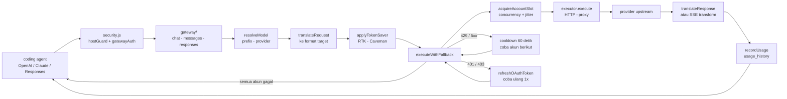
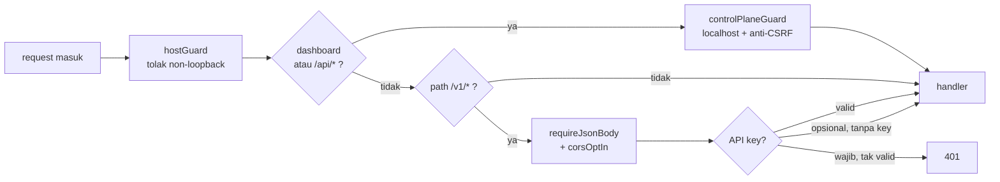
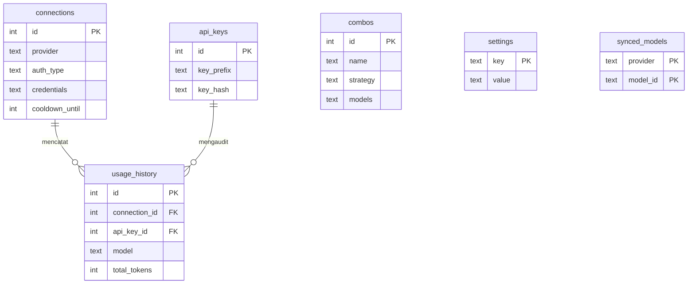

# zenroute

Gateway AI personal yang ringan untuk coding agent, kompatibel dengan endpoint OpenAI Chat Completions dan Anthropic Messages. Disederhanakan dari 9router dan OmniRoute: Hono, `node:sqlite`, tanpa build step frontend, dan hanya 2 dependensi runtime.

## Spesifikasi Teknis

- **Runtime**: Node.js 22+ (ESM)
- **HTTP**: Hono + `@hono/node-server`
- **Database**: `node:sqlite` (`DatabaseSync`), tanpa kompilasi native
- **Dashboard**: HTML template string yang dirender server, tanpa React/Next.js
- **Port Default**: `20120` (dipisahkan agar tidak tabrakan dengan 9router/OmniRoute di port `20128`)
- **Bind Default**: `127.0.0.1`

## Status Fitur

Sudah berfungsi:
- `POST /v1/chat/completions`, `POST /v1/messages`, `POST /v1/responses`, `GET /v1/models`, streaming SSE dan non-streaming.
- Translasi penuh OpenAI ↔ Claude untuk `/v1/chat/completions` dan `/v1/messages` (termasuk translasi skema tool calling dan tool execution).
- Failover otomatis ke akun berikutnya saat 429 atau 5xx sebelum byte pertama dikirim, akun bermasalah diberi cooldown 60 detik.
- **Traffic Guard & Request Pacing**: Pembatas konkurensi in-flight per akun (default: 2 untuk OAuth) dengan antrean FIFO otomatis, serta *proactive jitter* (100–300ms) untuk memecah pola burst bot dan *reactive failover jitter* (50–150ms).
- **Strategi Rotasi Akun**: Opsi `lru` (round-robin least-recently-used) atau `sticky` (mempertahankan akun yang sama hingga cooldown/limit) yang dapat diatur via dashboard Settings.
- **Isolasi Proxy & Refresh Token Aman**: Seluruh alur OAuth (pertukaran kode, polling device code, minting token, hingga refresh token) diteruskan melalui `proxy_url` akun dengan jaminan fail-closed. Dilengkapi single-flight concurrency lock untuk mencegah race condition pada Refresh Token Rotation (RTR).
- Connection per provider di SQLite, refresh token proaktif & reaktif setelah 401/403, proxy HTTP/HTTPS per connection.
- Manajemen **Providers**: halaman terpadu untuk akun dan model per provider (OAuth, Free Tier, API Key) dengan toggle enable/disable, penambahan model custom, dan peringatan cakupan scope izin pada modal login.
- **Sinkronisasi Model Gratis Otomatis**: Provider dengan katalog gratis (OpenCode, Kilo Code, Ollama, Cline, OpenRouter, OVHcloud, xKiro, serta GLM, Bazaarlink, dan Mistral saat akun terhubung) otomatis menyinkronkan model gratis saat startup dan berkala (default tiap 6 jam), dilengkapi tombol *Sync Now*.
- **Import Model Live**: Import daftar model dari upstream (OpenCode, Kilo Code, Ollama, GLM, GitHub, Claude, Mistral, OVHcloud, xKiro) dengan pilihan filter model gratis/semua dan fitur *Delete Selected* berbasis checkbox.
- Registry 21 provider (codex, github, kiro, antigravity, glm, claude, opencode, kilocode, nvidia, cline, mistral, cloudflare-ai, openrouter, llm7, bazaarlink, together, freebuff, ollama, commandcode, ovhcloud, xkiro) disinkronkan dengan 9router & OmniRoute.
- API key gateway (`zr_...`) yang disimpan sebagai hash, akses dashboard hanya dari localhost, proteksi CSRF, DNS rebinding, dan header `Cache-Control: no-store` untuk mencegah stale state.
- Usage tracking untuk streaming (`stream_options.include_usage` + fallback estimasi) dan non-streaming, audit trail pemakaian per API key (`api_key_id`), status kuota, RTK, Caveman (opt-in), dan halaman terpisah **Token Saver**.

- **Login akun OAuth ala 9router**: Claude, Codex (ChatGPT), Antigravity (Google), dan Cline login lewat browser dengan callback ke zenroute. GitHub Copilot, Kilo Code, Kiro (AWS Builder ID), dan GLM (Z.ai) memakai device code. Kiro, Freebuff, dan Command Code juga bisa import login dari instalasi CLI lokal di mesin yang sama (~/.commandcode/auth.json). Tempel token manual tetap tersedia sebagai cadangan. Token diperpanjang otomatis sesuai cara tiap provider.
- **Routing Chat Multi-Format**: Mendukung translasi penuh dua arah untuk OpenAI Chat Completions, Anthropic Claude Messages, OpenAI Responses API (Codex backend), Google Cloud Code / Gemini v1internal (Antigravity), dan AWS EventStream binary (Kiro AI).
- **Live Quota Fetcher**: Mengambil kuota, sisa token, rate limit, dan status tier langsung dari endpoint resmi provider (Codex, Antigravity, GitHub Copilot, GLM Z.ai, OpenRouter).

## Instalasi & Menjalankan

Syarat: **Node.js v22+** (karena menggunakan modul bawaan `node:sqlite`).

### 1. Clone & Jalankan Lokal
```bash
git clone <url-repo-zenroute>
cd zenroute
npm install
npm start          # atau: npm run dev
```

### 2. Pasang sebagai Global CLI (`zenroute`)
Dari dalam folder repository hasil clone:
```bash
npm link
```
Setelah itu, perintah `zenroute` dapat dipanggil dari direktori mana saja:
```bash
zenroute
```

Saat dijalankan di terminal interaktif (TTY), zenroute menampilkan banner status dan menu pilihan untuk membuka dashboard di browser.

## Langkah Pemakaian

1. Buka **Providers** (`http://127.0.0.1:20120/dashboard/providers`), pilih provider, lalu klik **Add Account**. Provider OAuth punya tombol login: selesaikan login di tab yang terbuka atau masukkan kode device yang tampil, dan akun tersimpan otomatis. Provider API key cukup diisi key-nya. Provider bertanda **Ready** (seperti OpenCode Free) bisa langsung dipakai tanpa akun.

   Login Codex memakai `http://localhost:1455/auth/callback` (redirect resmi Codex CLI), jadi port 1455 harus kosong selama login. Login lain kembali ke `http://localhost:20120/callback`. Kalau browser tidak kembali otomatis, tempel URL callback di modal.
2. Buka **API Keys**, buat key gateway untuk tiap coding agent/klien. Key lengkap hanya ditampilkan sekali saat dibuat.
3. Opsional: aktifkan **Require API Key** di **Settings**, atau atur optimasi prompt di **Token Saver**.
4. Kirim request dengan model berprefix provider:

```powershell
$key  = "zr_..."   # dari halaman API Keys
$body = @{ model = "glm/glm-5.2"; messages = @(@{ role = "user"; content = "Halo" }) } | ConvertTo-Json -Depth 5
Invoke-RestMethod -Uri "http://127.0.0.1:20120/v1/chat/completions" -Method Post `
  -ContentType "application/json" -Headers @{ Authorization = "Bearer $key" } -Body $body
```

Prefix menentukan provider (`cc`, `cx`, `gh`, `kr`, `ag`, `glm`, `oc`, `kc`, `nv`, `cl`, `pol`, `cf`, `or`, `llm7`, `bzl`, `together`, `fb`, atau id provider). Nama model setelah `/` diteruskan apa adanya.

Key zenroute hanya membuka akses ke gateway dan tidak pernah diteruskan ke provider. Kredensial provider selalu diambil dari database lokal; tanpa connection aktif (kecuali provider no-auth/free), gateway membalas 503.

## Topologi

Tiga diagram di bawah meniru pola `docs/diagrams/` OmniRoute (`request-pipeline.mmd`, `authz-pipeline.mmd`, `db-schema-overview.mmd`), tetapi isinya disesuaikan dengan kode zenroute yang sebenarnya.

### Alur request gateway



### Lapis keamanan request



### Skema database



Tabel lain tanpa relasi FK: `custom_models`, `disabled_models`, `imported_models`, `model_sync_state`.

## Konfigurasi (Environment)

| Variabel | Default | Fungsi |
|---|---|---|
| `PORT` | `20120` | Port server |
| `HOST` | `127.0.0.1` | Alamat bind. Selain loopback, API key otomatis wajib |
| `ZENROUTE_DB_PATH` | `<root>/data/zenroute.db` | Lokasi database |
| `ZENROUTE_ALLOWED_HOSTS` | kosong | Host tambahan yang diterima saat bind loopback |
| `ZENROUTE_CORS_ORIGINS` | kosong (CORS mati) | Origin browser yang boleh memanggil `/v1` |
| `ZENROUTE_UPSTREAM_HEADERS_TIMEOUT_MS` | `300000` | Batas tunggu header respons upstream |
| `ZENROUTE_UPSTREAM_IDLE_TIMEOUT_MS` | `120000` | Batas jeda antar-chunk stream upstream |
| `ZENROUTE_MODEL_SYNC_INTERVAL_HOURS` | `6` | Interval sinkron model gratis; `0` mematikan sinkron otomatis |

Header `x-zenroute-token-saver: false` mematikan RTK dan Caveman untuk satu request.

## Keamanan

- Server listen di `127.0.0.1`; dashboard dan `/api/*` hanya menerima klien localhost.
- Kredensial provider tersimpan plaintext di `data/zenroute.db`. Jangan bagikan atau commit file ini.
- Detail lengkap ada di `.workspace/context/SECURITY.md`.

## Test

```powershell
npm test   # node --test, database otomatis :memory:
```

## Struktur Folder

```
zenroute/
├── bin/
│   └── zenroute.js       # CLI entry point dengan interactive menu
├── src/
│   ├── index.js          # Entry point HTTP server, middleware, routes
│   ├── security.js       # Host guard, access control, CSRF, CORS, gateway auth
│   ├── db/               # node:sqlite repository dan skema database
│   ├── gateway/          # Handlers: chat.js, messages.js, responses.js, models.js
│   ├── translator/       # Translasi OpenAI <-> Claude/Gemini/Kiro/Responses
│   ├── providers/        # Registry 21 provider & model routing resolution
│   ├── executors/        # base.js + proxy.js + executor khusus (codex, kiro, ...)
│   ├── config/           # freeTierCatalog.js
│   ├── services/         # apiKeys, auth, fallback, tokenRefresh, trafficGuard,
│   │                     # usage, quota (+ per-provider), modelOverrides,
│   │                     # modelImport, modelSync, tokenSaver (+ rtk, caveman),
│   │                     # settings, logger, oauth/ (flows + providers)
│   ├── utils/            # eventstream.js (helper SSE)
│   └── ui/               # layout.js, html.js, cliMenu.js, assets.js,
│                         # pages/ (overview, providers, oauth, usage,
│                         # tokenSaver, settings, apiKeys)
├── tests/                # 36 file test, 185 test via node --test
└── package.json
```
